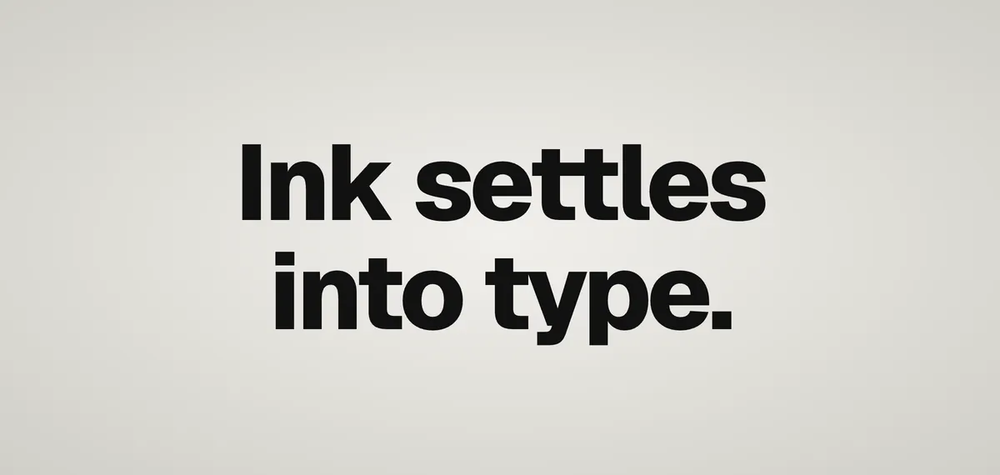

<div align="center">

<picture>
  <source media="(prefers-color-scheme: dark)" srcset="media/hero-dark.webp" />
  
</picture>

# Melt reveal

A scroll text reveal. Each line flips up out of a clip while its ink melts on the GPU from a halftone dot screen into crisp type, scrubbed by your scroll.

**[Play with it](https://melt-reveal.jsfowles.com)** · [Quick start](#quick-start) · [API](#api) · [Settings](#settings)

<sub>One file, <a href="src/melt.ts"><code>src/melt.ts</code></a>. GSAP is the only dependency.</sub>

</div>

## Quick start

Install GSAP 3.13 or later. SplitText comes with it now, for free.

```bash
npm install gsap
```

Copy [`src/melt.ts`](src/melt.ts) into your project. It adds the little CSS it needs itself.

> [!TIP]
> Or hit **Copy melt.ts** in the playground, and **Copy settings** for the feel you tuned there.

Then point it at some text:

```ts
import { meltReveal, DEFAULTS } from "./melt";

document.fonts.ready.then(() => {
  for (const el of document.querySelectorAll<HTMLElement>(".reveal")) {
    meltReveal(el, DEFAULTS);
  }
});
```

Wait for your fonts first. The lines get measured when they split, and a fallback font measures differently.

That's it. The rest is optional.

## Recipes

### Your own settings

Tune it in the playground and hit **Copy settings**. You only get what you changed:

```ts
meltReveal(el, { ...DEFAULTS, amount: 0.8 });
```

### Play it once

Pass a third argument and it comes off the scroll. You get a paused timeline, and `duration` is in real seconds.

```ts
meltReveal(heading, { ...DEFAULTS, duration: 0.9 }, (tl) => tl.play());
```

### Clean up

`meltReveal` returns an undo. Call it when the element goes away, like before a client-side page change. Resizing is handled for you.

### Reduced motion

It doesn't check for you. Skip it and the text just sits there:

```ts
if (!matchMedia("(prefers-reduced-motion: reduce)").matches) {
  meltReveal(el, DEFAULTS);
}
```

<details>
<summary><b>Smooth scrolling</b></summary>

It works fine with plain scrolling. If you add [Lenis](https://github.com/darkroomengineering/lenis), run it on GSAP's ticker so they stay in sync:

```ts
import Lenis from "lenis";
import { gsap } from "gsap";
import { ScrollTrigger } from "gsap/ScrollTrigger";

const lenis = new Lenis({ lerp: 0.14, autoRaf: false });
lenis.on("scroll", ScrollTrigger.update);
gsap.ticker.add((time) => lenis.raf(time * 1000));
gsap.ticker.lagSmoothing(0);
```

Keep Lenis to mice and trackpads. On a phone, native scrolling already glides, and smoothing it makes the page trail your finger.

</details>

<details>
<summary><b>React</b></summary>

```tsx
import { useEffect, useRef } from "react";
import { meltReveal, DEFAULTS } from "./melt";

export const Reveal = ({ children }: { children: string }) => {
  const el = useRef<HTMLParagraphElement>(null);

  useEffect(() => {
    let undo: (() => void) | undefined;
    let gone = false;
    document.fonts.ready.then(() => {
      if (!gone) undo = meltReveal(el.current!, DEFAULTS);
    });
    return () => {
      gone = true;
      undo?.();
    };
  }, [children]);

  return <p ref={el}>{children}</p>;
};
```

Same idea anywhere else: start it once the fonts are in, undo it when it goes away.

</details>

## API

| Call                              | Does                                                                                 |
| --------------------------------- | ------------------------------------------------------------------------------------ |
| `meltReveal(el, settings)`        | Reveals each line of `el` as it scrolls through the screen. Returns an undo.         |
| `meltReveal(el, settings, build)` | Comes off the scroll: `build` gets a paused timeline of every line. Returns an undo. |
| `DEFAULTS`                        | The default settings, to spread your changes over.                                   |

`build` runs again whenever the text re-splits, on a resize or a font swap, with a fresh timeline.

## Settings

| Setting       | Default      | Range      | Does                                                       |
| ------------- | ------------ | ---------- | ---------------------------------------------------------- |
| `start`       | `85`         | 20–100%    | Where on screen a line starts revealing, from the top.     |
| `end`         | `65`         | 0–95%      | Where it finishes.                                         |
| `smooth`      | `0`          | 0–2s       | How long it lags behind your scroll. `0` follows exactly.  |
| `flip`        | `true`       |            | Words swing up out of their clips.                         |
| `angle`       | `-90`        | −180–0°    | How far back each word starts tipped.                      |
| `travel`      | `150`        | 0–200%     | How far below its clip each word starts.                   |
| `depth`       | `1`          | 0–2em      | How far behind the text it pivots. Deeper swings wider.    |
| `perspective` | `3`          | 1–30em     | Closer looks more 3D.                                      |
| `duration`    | `0.4`        | 0.1–2s     | The flip. Only matters as a ratio unless you play it once. |
| `ease`        | `power3.out` | any GSAP   | Used for both the flip and the melt.                       |
| `melt`        | `true`       |            | The ink settles out of a dotted blur.                      |
| `amount`      | `0.4`        | 0–1.5em    | How blurry it starts.                                      |
| `dots`        | `0.79`       | 0–2        | How strong the dot grid is. Past 1 it breaks into blobs.   |
| `dotSize`     | `0.09`       | 0.03–0.6em | Size of each dot.                                          |
| `hardness`    | `27.5`       | 1–60       | How sharp the edge is. Low gets cloudy.                    |
| `length`      | `1.3`        | 0.3–3×     | How long the melt runs compared to the flip.               |

The playground's presets are good starting points: **Default** (the defaults, with a 1s flip), **Wordmark** (coarser dots, lighter blur), **Halftone** (coarse dots, softer edge), **Flip only** and **Ink only**.

## Good to know

- SplitText labels the element with its full text, so screen readers read it as one paragraph.
- The melt runs in WebGL. Lines have their text drawn into textures eight at a time, ahead of the start rule in frames with time to spare, since in Safari a texture upload costs about the same whatever its size. Each frame every line mid-reveal is tipped, blurred, screened with dots and cut in shaders, in four passes however many lines melt, onto a canvas only as tall as the band of lines melting. So it holds 60fps in Safari, and a phone has far less to do. Its own text stays in the page for layout, selection and screen readers, hidden until the line lands. Lines waiting or landed cost nothing.
- The canvas goes in the text's layer: the nearest positioned ancestor with a `z-index`, or the page. So the melt paints over the text and under whatever covers it, like a sticky header. It isn't clipped by an `overflow: hidden` box in between, though.
- Only the glyphs are drawn, in each text node's font and colour. Underlines, backgrounds and shadows on inline markup disappear while a line melts and come back when it lands.
- The melt is drawn over the line, outside the words' clips, so it spills softly past them.
- Without WebGL 2 it falls back to an SVG filter on each line. Safari paints those on the CPU, so there keep `amount` × font size under about 20px on big type, and lower on phones; the playground caps phones at 8px. Safari also drops the filter over 3D-transformed words, so in the fallback the flip is drawn flat: each word slides up from squashed instead of tipping in 3D.
- Lines are measured when you call it. If something moves the page after that, like an intro that slides content in, call `ScrollTrigger.refresh()` once it settles, or lines start late.
- Agents can read [llms.txt](https://melt-reveal.jsfowles.com/llms.txt), with the README and the source of `melt.ts` in one file at [llms-full.txt](https://melt-reveal.jsfowles.com/llms-full.txt).

> [!NOTE]
> I've tested it in Chrome and iOS Safari, on plain paragraphs. Check Firefox and any inline markup you've got.

## The playground

```bash
npm install
npm run dev
```

It's an Astro page. Scroll to proof the reveal, scrub the inspector line to step through one, and tune it in the settings, a side column on desktop and a dock of tabs on a phone. `npm run check` typechecks and formats. The effect is `src/melt.ts`, everything else is the playground.

## License

MIT. Geist and Geist Mono are under the SIL Open Font License.
